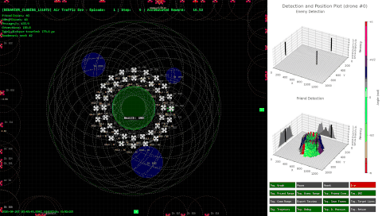

# DroneSwarm2D

**A 2-D simulator for studying distributed defensive tactics with swarms of autonomous drones.**

[](https://github.com/lucasll37/DroneSwarm2D-lib/actions/workflows/tests.yml)


🇧🇷 [Leia em português](README.pt-BR.md)



DroneSwarm2D simulates a swarm of defensive drones protecting an asset (the *interest point*) from low-cost attacking drones. There is no central controller: each defensive drone builds its own picture of the battlefield from its sensors and from what its neighbours tell it over a lossy ad-hoc network, and then decides what to do on its own. The library was developed as an undergraduate thesis at ITA (Instituto Tecnológico de Aeronáutica).

## Contents

- [Features](#features)
- [Installation](#installation)
- [Quick start](#quick-start)
- [How it works](#how-it-works)
- [Writing your own behaviour](#writing-your-own-behaviour)
- [Configuration](#configuration)
- [Running experiments](#running-experiments)
- [Interactive interface](#interactive-interface)
- [Performance](#performance)
- [Project layout](#project-layout)
- [Development](#development)
- [Research motivation and findings](#research-motivation-and-findings)
- [License and contact](#license-and-contact)

**Documentation:** [architecture](docs/en/architecture.md) · [configuration reference](docs/en/configuration.md) · [behaviour guide](docs/en/behaviors.md) · [API reference](docs/en/api.md) · [changelog](CHANGELOG.md)

## Features

- **Distributed decision-making.** Every drone runs its own policy on its own perception; nobody sees the whole battlefield.
- **Ad-hoc communication.** Links to the *N* nearest drones within range, symmetric links, probabilistic message loss and retransmissions.
- **Local perception.** Each drone stores what it knows as grid matrices of detection *recency* and *heading* that fade over time and are merged by timestamp.
- **Direct or passive detection.** Passive mode only confirms a target seen by several sensors (triangulation). Faulty drones can be injected to broadcast garbage.
- **Several drone roles.** Mobile interceptors, airborne early warning (AEW) drones and fixed ground radars. Enemies use 11 randomised approach patterns (straight lines, zig-zags, spirals, bounces...) plus formation attacks, and react when detected.
- **Demilitarised zones** where no engagement may happen.
- **Pluggable behaviours.** A new defensive policy is a small Python class.
- **Experiment-friendly.** Gym-like `reset` / `step` API, fully reproducible runs from a seed, and a headless mode for batch experiments and CI.
- **Rich visualisation.** Interactive pygame interface, 3-D plots of a drone's perception, frame recording to video and Tacview export.

## Installation

DroneSwarm2D requires **Python 3.12+** and the **Cairo** graphics library, which is used to rasterise the SVG sprites.

| System | Cairo |
|---|---|
| Debian / Ubuntu | `sudo apt install libcairo2` |
| macOS | `brew install cairo` |
| conda (any OS) | `conda install -c conda-forge cairo` |

Install the library from GitHub:

```bash
pip install "DroneSwarm2D @ git+https://github.com/lucasll37/DroneSwarm2D-lib.git"
```

Optional extras:

- `pip install "DroneSwarm2D[analysis] @ git+..."` adds pandas, seaborn, SciPy, scikit-learn, OpenCV and Jupyter for data analysis.
- `pip install "DroneSwarm2D[dev] @ git+..."` adds the test and lint tools.

To work on the library itself, install it from a clone:

```bash
git clone https://github.com/lucasll37/DroneSwarm2D-lib.git
cd DroneSwarm2D-lib
pip install -e ".[dev]"      # or: make create_env  (conda env in ./.venv with pinned versions)
```

## Quick start

Create a starter project and run it:

```bash
python -m DroneSwarm2D init          # or simply: droneswarm2d init
cd droneSwarm2D-project
python src/main.py --windowed        # interactive window (omit --windowed for full screen)
python src/main.py --headless --episodes 20 --seed 7   # no window, as fast as possible
```

The project contains `src/config.json` (the scenario), `src/behaviors.py` (your drone policies), `src/main.py` (the episode loop) and a tutorial.

A minimal script looks like this:

```python
import DroneSwarm2D

# 1. Load the scenario first: the rest of the library reads it at import time.
settings = DroneSwarm2D.init("config.json", headless=True)

# 2. Create the environment. mode="human" opens the UI, mode=None runs headless.
env = DroneSwarm2D.AirTrafficEnv(
    mode=None,
    seed=42,
    enemy_behavior=settings.ENEMY_BEHAVIOR,
    demilitarized_zones=settings.DMZ,
)

# 3. Run one episode.
obs, done = env.reset()
while not done:
    obs, reward, done, info = env.step(None)

print(info["enemies_shotdown"], info["sucessful_attacks"], info["interest_point_health"])
env.close()
```

> **Important:** call `DroneSwarm2D.init()` before importing `DroneSwarm2D.behaviorsDefault`, `DroneSwarm2D.core.utils` or your own behaviours. These modules read the configuration when they are imported.

## How it works

Each call to `env.step()` advances the world by one tick:

1. **Friendly drones** (in order):
   - *forget*: their intensity matrices decay by `DECAY_FACTOR`;
   - *link*: they pick their communication neighbours;
   - *sense*: they detect enemies (directly, or only when `N_LINE_SIGHT_CROSSING` sensors cover them) and friends;
   - *talk*: they merge their matrices with their neighbours `CICLE_COMM_BY_STEP` times, and each message may be lost;
   - *act*: they ask their **behaviour** for a velocity and move.
2. **Enemies** move with their pattern. When a friend comes within `ENEMY_DETECTION_RANGE`, an enemy either commits to a straight *desperate attack* or *escapes* for a while; the more aggressive it is, the more likely it attacks, and aggressiveness grows as it gets closer to the target.
3. **Attacks.** An enemy that reaches the interest point damages it and is removed. Each hit also destroys one ground radar.
4. **Engagements.** Every friend/enemy pair closer than `NEUTRALIZATION_RANGE` fights. The `NEUTRALIZATION_PROB_*` settings decide whether the enemy, the friend or both are destroyed. Enemies inside an active demilitarised zone cannot be engaged.
5. **Reward.** The reward grows with the enemies' distance to the target and with the enemies shot down, and is penalised by every successful attack.

The defensive drones' perception lives on a grid of `CELL_SIZE`-pixel cells. A detection sets its cell's *intensity* to 1, and the intensity then fades by `DECAY_FACTOR` every step. When two drones talk, each cell is copied from whoever saw it more recently. The full model is described in [docs/en/architecture.md](docs/en/architecture.md).

## Writing your own behaviour

A behaviour receives only the drone's **local** perception and returns a label and a velocity:

```python
# Runs after DroneSwarm2D.init(...)
import numpy as np
import pygame

import DroneSwarm2D
from DroneSwarm2D.behaviorsDefault import BaseBehavior, BehaviorType
from DroneSwarm2D.core import settings
from DroneSwarm2D.core.utils import active_cells, cell_center, intercept_direction


class ChaseClosestThreat(BaseBehavior):
    def __init__(self):
        super().__init__(BehaviorType.COMMON)

    def apply(self, state, joystick_controlled=False):
        pos = pygame.math.Vector2(*np.squeeze(state["pos"]).tolist())
        enemies = active_cells(np.squeeze(state["enemy_intensity"]), threshold=0.4)
        if not enemies:
            return ("IDLE", None, None, None), pygame.math.Vector2(0, 0)

        # Target the enemy closest to the interest point.
        cell = min(enemies, key=lambda c: cell_center(c).distance_to(settings.INTEREST_POINT_CENTER))
        heading = pygame.math.Vector2(*np.squeeze(state["enemy_direction"])[cell])
        velocity = intercept_direction(pos, settings.FRIEND_SPEED, cell_center(cell), heading * settings.ENEMY_SPEED)
        return ("PURSUING", cell_center(cell), None, None), velocity


env = DroneSwarm2D.AirTrafficEnv(friend_behavior=ChaseClosestThreat(), ...)
```

The [behaviour guide](docs/en/behaviors.md) explains the `state` dictionary and the helper functions, walks through the default policy (greedy assignment, interception and "hold" states) and gives more examples.

## Configuration

A scenario is a JSON file. A string value is evaluated as a Python expression over the keys defined above it:

```json
{
  "FRIEND_COUNT": 8,
  "ENEMY_COUNT": 8,
  "SIM_WIDTH": "int(FULL_WIDTH * 0.7)",
  "INTERNAL_RADIUS": "min(SIM_WIDTH, SIM_HEIGHT) / 10",
  "EXTERNAL_RADIUS": "INTERNAL_RADIUS * 4",
  "ENEMY_BEHAVIOR": "None",
  "DMZ": [["SIM_WIDTH * 0.35", "SIM_HEIGHT * 0.30", 60]]
}
```

| Group | Main keys |
|---|---|
| Forces | `FRIEND_COUNT`, `ENEMY_COUNT`, `RADAR_COUNT`, `AEW_COUNT`, `BROKEN_COUNT` |
| Sensors and links | `FRIEND_DETECTION_RANGE`, `AEW_DETECTION_RANGE`, `RADAR_DETECTION_RANGE`, `ENEMY_DETECTION_RANGE`, `COMMUNICATION_RANGE`, `N_CONNECTIONS`, `CICLE_COMM_BY_STEP`, `MESSAGE_LOSS_PROBABILITY` |
| Perception | `CELL_SIZE`, `DECAY_FACTOR`, `PASSIVE_DETECTION`, `N_LINE_SIGHT_CROSSING` |
| Geometry | `INTERNAL_RADIUS`, `EXTERNAL_RADIUS`, `INITIAL_DISTANCE`, `RADAR_RANGE`, `AEW_RANGE`, `DMZ` |
| Combat | `NEUTRALIZATION_RANGE`, `NEUTRALIZATION_PROB_*`, `INTEREST_POINT_DAMAGE`, `INITIAL_AGGRESSIVENESS`, `ESCAPE_STEPS` |
| Enemies and control | `ENEMY_BEHAVIOR` (pattern or `"None"` for random), `JOYSTICK` (`"Friend"`, `"Enemy"` or `"None"`) |

Every key is documented in the [configuration reference](docs/en/configuration.md). The configuration is evaluated with `eval`, so only load files you trust.

## Running experiments

- **Reproducibility.** The same configuration, seed and screen size always produce the same episode. Since the sizes derive from the screen, pass `screen_size=(1920, 1080)` to `init` to make results independent of the monitor.
- **Headless runs.** `DroneSwarm2D.init(config, headless=True)` together with `AirTrafficEnv(mode=None)` runs without a window, as fast as the CPU allows. Use it on servers and in batch experiments.
- **Metrics.** `step()` returns an `info` dictionary:

| Key | Meaning |
|---|---|
| `current_step`, `accum_reward` | Episode progress |
| `enemies_shotdown` | Enemies destroyed in combat |
| `friends_shotdown` | Friendly drones destroyed (in combat, or radars hit by an attack) |
| `sucessful_attacks`, `interest_point_health` | Damage taken by the defended asset |
| `friends_returned` | Drones that landed after "return to base" |
| `enemies_remaining`, `friends_remaining` | Drones still alive |
| `state_percentages` | Share of time the swarm spent in each behaviour label |
| `total_distance_traveled` | Distance flown by the swarm, in pixels |

The original (misspelled) key names, such as `sucessful_attacks`, are kept for backward compatibility.

## Interactive interface

With `mode="human"` the window shows:

- **Simulation area (left).** Friendly drones (white), enemies (red), the interest point (green, turning red as it loses health), sensor ranges, communication links, demilitarised zones and the fused enemy heat-map.
- **Perception panel (right).** A 3-D plot of the selected drone's enemy and friend matrices. Height is recency and colour is heading. Click a drone to select it.
- **Control panel.** Toggle buttons for each layer, plus pause, reset, exit, *return to base* (all drones fly home), passive detection, Tacview export (`./output/`) and frame recording (`./tmp/`). Turn recorded frames into a video with `python -m DroneSwarm2D create_video ./tmp/frames_...`.

With `JOYSTICK` set to `"Enemy"` (or `"Friend"`), a game pad flies one enemy (or the leading friendly drone).

## Performance

The engine was optimised in this release. The perception scans, neighbour selection, sensor coverage, line-of-sight tracing and matrix merging are now vectorised; the 30 MB-per-drone triangulation grid is no longer allocated every step; fonts are cached; and the drawing of trajectories is cropped. Measured on the same scenario (24 vs 24 drones, 1920×1080, `make benchmark`) and checked step by step to produce identical results:

| | Before | After | Speed-up |
|---|---:|---:|---:|
| Headless step, direct detection | 122 ms | 15.7 ms | 7.8× |
| Headless step, passive detection | 123 ms | 18.9 ms | 6.5× |
| Rendered frame | 220 ms | 30 ms | 7.4× |

Run `make benchmark ARGS="--friends 50 --enemies 50 --passive"` to measure your own scenarios.

## Project layout

```
DroneSwarm2D/
├── __init__.py            # init() and the public classes
├── cli.py                 # python -m DroneSwarm2D init | create_video
├── core/
│   ├── settings.py        # configuration loader
│   ├── AirTrafficEnv.py   # environment: step, combat rules, reward, UI
│   ├── FriendDrone.py     # perception, communication, motion
│   ├── EnemyDrone.py      # attack patterns
│   ├── InterestPoint.py   # defended asset
│   ├── DemilitarizedZone.py
│   ├── rendering.py       # drawing helpers and widgets
│   └── utils.py           # grid geometry, interception, matrices
├── behaviorsDefault/      # BaseBehavior, BehaviorType, default policies
├── tools/create_video.py
├── templates/             # project created by `init`
└── assets/                # sprites
example/                   # ready-to-run example (same code as the template)
tests/                     # pytest suite
benchmarks/                # performance measurement
docs/en, docs/pt-BR/       # documentation
```

## Development

```bash
make install-dev    # editable install with pytest, pytest-cov and ruff
make test           # run the test suite (headless)
make coverage       # tests with a coverage report
make lint           # ruff
make benchmark      # simulation speed
make demo           # run the example (ARGS="--windowed --episodes 5")
```

Continuous integration runs the linter and the test suite on every push. See [CONTRIBUTING.md](CONTRIBUTING.md) for the guidelines.

## Research motivation and findings

Cheap drones, often improvised from simple materials, have changed modern conflicts. Conventional air defences are expensive and struggle against swarm attacks. DroneSwarm2D explores decentralised defensive swarms that:

1. eliminate single points of failure, which are common in centralised systems;
2. are cost-effective compared with traditional countermeasures;
3. respond flexibly and scale to diverse threats;
4. optimise tactical coordination through distributed-computing principles.

The simulator compares three defensive strategies:

1. **Benchmark (non-cooperative).** Drones operate independently, without communication.
2. **Proposed (distributed).** Drones share information over the ad-hoc network.
3. **Centralised.** Drones have complete global information.

In the thesis experiments:

- the distributed approach clearly outperformed the non-cooperative one;
- the gap between the distributed and centralised approaches was small in many scenarios;
- the distributed strategy was more resilient to communication failures and to enemy adaptation.

Kolmogorov–Smirnov and Mann–Whitney tests confirmed that the differences in the performance metrics are statistically significant.

## License and contact

See [LICENSE](LICENSE). For questions or collaboration, contact [lucas.silva1037@gmail.com](mailto:lucas.silva1037@gmail.com).
